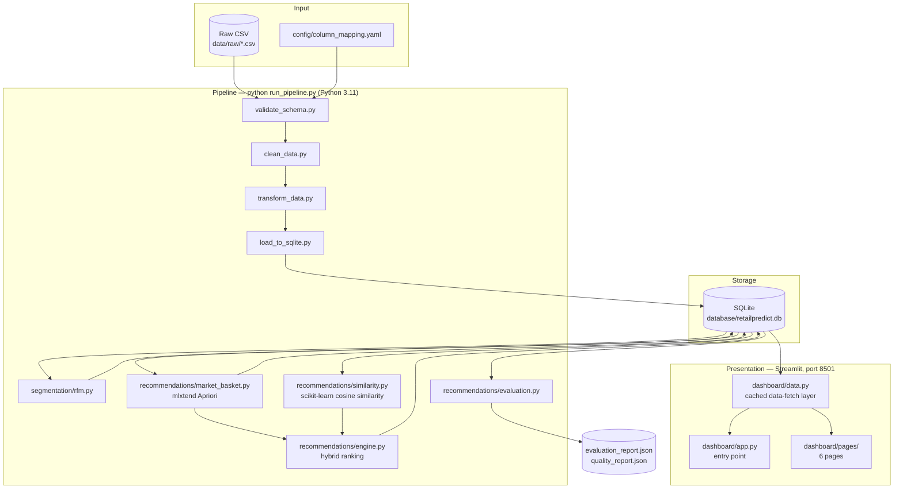

# RetailPredict


> Local, explainable retail analytics: a raw transaction CSV in, a six-page BI dashboard and reasoned product recommendations out — no cloud, no paid APIs, no black-box scores.

## Table of Contents

- [What is RetailPredict?](#what-is-retailpredict)
- [Architecture Overview](#architecture-overview)
- [Pipeline Execution Flow](#pipeline-execution-flow)
  - [Failure Handling](#failure-handling)
- [Tech Stack](#tech-stack)
  - [Components](#components)
  - [Infrastructure and Libraries](#infrastructure-and-libraries)
- [Project Structure](#project-structure)
- [Quick Start](#quick-start)
  - [Prerequisites](#prerequisites)
  - [Steps](#steps)
  - [Using the real UCI dataset](#using-the-real-uci-dataset)
  - [Using your own CSV](#using-your-own-csv)
- [Dashboard Pages and CLI Reference](#dashboard-pages-and-cli-reference)
  - [Dashboard pages](#dashboard-pages)
  - [CLI reference](#cli-reference)
- [Configuration](#configuration)
- [Development Tools](#development-tools)
- [Database Schema](#database-schema)
- [Methodology](#methodology)
  - [Customer Segmentation](#customer-segmentation)
  - [Recommendation Engine](#recommendation-engine)
- [Evaluation](#evaluation)
- [Design Decisions](#design-decisions)
  - [Why SQLite instead of PostgreSQL?](#why-sqlite-instead-of-postgresql)
  - [Why rule-based RFM instead of K-Means?](#why-rule-based-rfm-instead-of-k-means)
  - [Why a three-tier hybrid recommender instead of one model?](#why-a-three-tier-hybrid-recommender-instead-of-one-model)
  - [Why materialize rules and recommendations instead of computing them live?](#why-materialize-rules-and-recommendations-instead-of-computing-them-live)
  - [Why rank-based RFM quintiles instead of raw-value quintiles?](#why-rank-based-rfm-quintiles-instead-of-raw-value-quintiles)
- [Testing](#testing)
- [Known Limitations](#known-limitations)
- [Future Scope](#future-scope)
- [Contributing](#contributing)
- [License](#license)

---

## What is RetailPredict?

RetailPredict turns a raw retail transaction CSV into a cleaned SQLite database, rule-based RFM customer segments, and a hybrid product-recommendation engine, then serves all of it through a six-page Streamlit dashboard. It's built for retailers, analysts, and data-science portfolios that need to answer who's valuable, who's at risk, and what to cross-sell — without standing up cloud infrastructure or paying for an API. What makes it noteworthy is its commitment to explainability: every segment assignment and every recommendation ships with a plain-language reason generated from the same rule that produced it, never a post-hoc justification for a black-box score. The entire stack — ingestion, cleaning, SQL analytics, segmentation, recommendations, evaluation, and dashboard — runs locally on free, open-source tools with zero configuration beyond one YAML file.

---

## Architecture Overview



`src/database/db.py` is the **only** module in the codebase that opens a SQLite connection — every pipeline stage, analytics query, and dashboard page goes through it, so there is exactly one definition of how the database is queried and how foreign keys get enforced.

---

## Pipeline Execution Flow

`run_pipeline.py` runs seven stages in strict dependency order — a linear batch job, not an event-driven or saga workflow, so a failure at any stage halts everything after it rather than triggering a rollback.

```mermaid
sequenceDiagram
    participant CLI as run_pipeline.py
    participant Val as validate_schema
    participant Clean as clean_data
    participant Trans as transform_data
    participant Load as load_to_sqlite
    participant DB as SQLite (retailpredict.db)
    participant RFM as segmentation/rfm
    participant MB as market_basket
    participant Eng as recommendations/engine
    participant Sim as similarity
    participant Ev as evaluation

    CLI->>Val: load_raw() + validate(df)
    Val-->>CLI: quality report (raises SchemaValidationError on failure)
    CLI->>Clean: clean(canonical_df)
    Clean-->>CLI: cleaned_df + cleaning_report
    CLI->>Trans: transform(cleaned_df)
    Trans-->>CLI: transformed_df -> clean_transactions.csv
    CLI->>Load: load(transformed_df, db_path)
    Load->>DB: CREATE TABLES (schema.sql) + bulk INSERT
    Load-->>CLI: verify() referential-integrity check
    CLI->>RFM: run(db_path)
    RFM->>DB: SELECT customer aggregates
    RFM->>DB: UPDATE customers (rfm scores, segment, segment_reason)
    CLI->>MB: run(db_path)
    MB->>DB: SELECT invoice baskets
    MB->>DB: INSERT association_rules (Apriori, mlxtend)
    CLI->>Eng: run(db_path)
    Eng->>MB: load_rules(db_path)
    Eng->>Sim: build(db_path)
    Sim->>DB: SELECT customer x product interactions
    Eng->>DB: INSERT recommendations (ranked, per customer)
    CLI->>Ev: run(db_path)
    Ev->>DB: time-based holdout split; rebuild rules/similarity on train period only
    Ev-->>CLI: evaluation_report.json (Precision/Recall/HitRate/Coverage)
```

### Failure Handling

| Stage | Failure Mode | Pipeline Behavior |
|---|---|---|
| Validate | Required column missing, or CSV unreadable | `SchemaValidationError` raised → logged → process exits `1`; no downstream stage runs |
| Validate | Raw CSV file not found at the configured path | `FileNotFoundError` caught in `main()` → logged → exits `1` |
| Clean | Every row removed by the cleaning filters | `ValueError` raised → logged → exits `1` (prevents building an empty database) |
| Load | Transactions reference an unknown customer/product | Logged as a `warning` with orphan-row counts; pipeline continues — `customer_id`/`product_id` foreign keys allow `NULL` |
| Evaluate | `--skip-evaluation` flag passed | Stage skipped entirely; pipeline still exits `0` |

---

## Tech Stack

### Components

| Component | Language | Runtime | Framework | Database | Role | Port |
|---|---|---|---|---|---|---|
| Pipeline CLI | Python 3.11 | CPython | argparse (stdlib) | SQLite | Batch ETL: clean, load, segment, recommend, evaluate | — (CLI) |
| Dashboard | Python 3.11 | CPython | Streamlit ≥1.30 | SQLite (read-only) | Six-page interactive BI dashboard | 8501 (default) |
| Sample data generator | Python 3.11 | CPython | argparse + NumPy | — | Synthetic UCI-shaped CSV for demo/dev | — (CLI) |

### Infrastructure and Libraries

| Component | Technology | Purpose |
|---|---|---|
| Database | SQLite (`sqlite3`, stdlib) | Single-file relational store; sole access via `src/database/db.py` |
| Data processing | Pandas ≥2.0, NumPy ≥1.24 | Cleaning, transforms, RFM computation |
| Association rules | mlxtend ≥0.23 (Apriori) | Market-basket rule mining |
| Similarity | scikit-learn ≥1.3 (cosine similarity) | Item-item recommendation tier |
| Charts | Plotly ≥5.18 | All dashboard visualizations |
| Config parsing | PyYAML ≥6.0 | Loads `config/column_mapping.yaml` |
| Testing | pytest ≥7.4 | 91 tests across data, SQL, segmentation, recommendations, dashboard |

All free and open source — no API keys anywhere in the codebase.

---

## Project Structure

```
RetailPredict/
├── config/
│   └── column_mapping.yaml      # dataset-agnostic ingestion config — remap columns, no code changes
├── data/
│   ├── raw/                     # your source CSV goes here (gitignored, .gitkeep only)
│   └── processed/                # clean_transactions.csv + quality/evaluation JSON reports (regenerated)
├── database/
│   └── retailpredict.db          # generated SQLite file (gitignored)
├── src/
│   ├── data/                     # validate_schema.py, clean_data.py, transform_data.py
│   ├── database/                 # schema.sql, load_to_sqlite.py, db.py (sole DB access boundary)
│   ├── analytics/                # customer_analytics.py, product_analytics.py, business_analytics.py, insights.py
│   ├── segmentation/             # rfm.py — quintile scoring + segment rule table
│   ├── recommendations/          # market_basket.py, similarity.py, popularity.py, engine.py, evaluation.py
│   └── utils/                    # config.py (YAML loader + paths), logging.py
├── dashboard/
│   ├── app.py                    # Streamlit entry point
│   ├── data.py                   # cached data-fetch layer — pages never touch src/database directly
│   ├── theme.py                  # colorblind-validated chart palette + Plotly styling
│   └── pages/                    # 1_Home.py … 6_Business_Insights.py (Streamlit auto-discovers these)
├── scripts/
│   └── make_sample_data.py       # synthetic UCI-shaped CSV generator for demo/dev
├── tests/                        # pytest suite mirroring src/ (91 tests)
├── run_pipeline.py                # single orchestration entry point
├── requirements.txt
└── pytest.ini
```

---

## Quick Start

### Prerequisites

| Tool | Min Version | Install |
|---|---|---|
| Python | 3.11 | https://www.python.org/downloads/ |
| pip | Bundled with Python 3.11 | Included with the Python installer |

### Steps

1. **Create and activate a virtual environment.**
   ```bash
   python -m venv .venv
   .venv\Scripts\activate          # Windows
   # source .venv/bin/activate     # macOS / Linux
   ```
2. **Install dependencies.**
   ```bash
   pip install -r requirements.txt
   ```
3. **Provide data.** If you have your own retail CSV, drop it into `data/raw/` and point `config/column_mapping.yaml` at it (see [below](#using-your-own-csv)). Otherwise generate a realistic synthetic dataset:
   ```bash
   python scripts/make_sample_data.py --rows 40000
   ```
4. **Run the pipeline** — cleans, loads, segments, recommends, and evaluates in one command:
   ```bash
   python run_pipeline.py
   ```
   This completes in well under a minute on a 40K-row dataset. Pass `--skip-evaluation` to skip the slowest stage while iterating.
5. **Launch the dashboard.**
   ```bash
   streamlit run dashboard/app.py
   ```
   Open http://localhost:8501 in your browser.

### Using the real UCI dataset

Download the [UCI Online Retail dataset](https://archive.ics.uci.edu/dataset/352/online+retail), save it as `data/raw/online_retail.csv`, and run the pipeline. The default column mapping already matches its schema.

### Using your own CSV

Edit `config/column_mapping.yaml` — map each canonical name to your file's column name. Nothing else changes:

```yaml
dataset:
  path: data/raw/my_orders.csv
columns:
  invoice_no: order_id
  product_id: sku
  customer_id: buyer_id
  # ...
```

---

## Dashboard Pages and CLI Reference

RetailPredict has no HTTP API — it's a local pipeline plus a Streamlit dashboard. These tables are the equivalent reference surface: what each dashboard page shows, and what each command-line entry point does.

### Dashboard pages

| Page | File | What it answers |
|---|---|---|
| Home | `dashboard/pages/1_Home.py` | How is the business doing overall? — KPIs, revenue trend, top products, segment mix |
| Customer Analytics | `dashboard/pages/2_Customer_Analytics.py` | Who is this customer and what should I offer them? — profile, history, spend trend, offers |
| Customer Segmentation | `dashboard/pages/3_Customer_Segmentation.py` | Which groups of customers matter most? — segment sizes/value, RFM scatter, country/segment/spend filters |
| Product Analytics | `dashboard/pages/4_Product_Analytics.py` | What sells, and what sells together? — best sellers by revenue and units, frequently-bought-together pairs |
| Recommendation Center | `dashboard/pages/5_Recommendation_Center.py` | What should we cross-sell, and why? — ranked recommendations with reasons, method mix, rule drill-down |
| Business Insights | `dashboard/pages/6_Business_Insights.py` | What should I pay attention to right now? — auto-generated findings, Pareto curve, data-quality and accuracy reports |

### CLI reference

| Command | Purpose | Key flags |
|---|---|---|
| `python run_pipeline.py` | Run the full pipeline end to end | `--dataset PATH`, `--db PATH`, `--skip-evaluation` |
| `python scripts/make_sample_data.py` | Generate a synthetic UCI-shaped CSV | `--rows` (default 50000), `--customers` (1200), `--products` (140), `--seed` (42), `--out` |
| `streamlit run dashboard/app.py` | Launch the dashboard | Standard Streamlit flags, e.g. `--server.port` |
| `python -m pytest` | Run the test suite | `-q`, `-k EXPR`, `-x` |

---

## Configuration

RetailPredict has no environment variables — every setting lives in [`config/column_mapping.yaml`](config/column_mapping.yaml), loaded once by `src/utils/config.py` and cached for the process lifetime. All keys below already ship with working defaults in the committed file.

| Key | Description | Default |
|---|---|---|
| `dataset.path` | Path to the raw CSV, relative to the repo root | `data/raw/online_retail.csv` |
| `dataset.encoding` | CSV text encoding | `latin-1` |
| `columns.*` | Canonical field name → your CSV's actual header (`invoice_no`, `product_id`, `description`, `quantity`, `invoice_date`, `unit_price`, `customer_id`, `country`) | UCI Online Retail headers |
| `cleaning.cancellation_prefix` | Invoice-number prefix that marks a cancellation | `C` |
| `cleaning.unknown_product_name` | Placeholder for missing product descriptions | `Unknown Product` |
| `cleaning.keep_guest_transactions` | Keep rows with no `CustomerID` for product-level analytics | `true` |
| `segmentation.quantiles` | Number of RFM scoring buckets | `5` |
| `recommendations.top_k` | Recommendations returned per customer | `5` |
| `recommendations.min_support` | Apriori minimum support | `0.02` |
| `recommendations.min_confidence` | Apriori minimum confidence | `0.3` |
| `recommendations.min_lift` | Apriori minimum lift | `1.0` |
| `recommendations.max_products_for_apriori` | Cap on products considered for rule mining | `300` |
| `recommendations.min_co_occurrence` | Minimum co-occurrence count for a product pair | `5` |
| `recommendations.max_products_for_similarity` | Cap on the item-item similarity matrix (grows O(n²) in product count) | `1500` |
| `recommendations.recent_products_considered` | Recent purchases used to seed association-rule lookups | `5` |

---

## Development Tools

| Tool | URL | Description |
|---|---|---|
| Streamlit dashboard | http://localhost:8501 | Six-page BI dashboard — `streamlit run dashboard/app.py` |

`database/retailpredict.db` is a plain SQLite file once generated — open it with any SQLite browser (e.g. DB Browser for SQLite) to inspect tables directly, no server required.

---

## Database Schema

```sql
customers(customer_id PK, country, first_purchase_date, last_purchase_date,
          total_orders, total_spend,
          recency_days, frequency, monetary,
          r_score, f_score, m_score, rfm_score, segment, segment_reason)

products(product_id PK, product_name, category)

transactions(transaction_id PK, invoice_no, customer_id FK, product_id FK,
             transaction_date, quantity CHECK(>0), unit_price CHECK(>0),
             revenue, country)

association_rules(rule_id PK, antecedent, consequent, support, confidence, lift)

recommendations(recommendation_id PK, customer_id FK, product_id FK,
                rank, score, source_method, reason_text)
```

Indexed on `customer_id`, `product_id`, `transaction_date`, `invoice_no`, `customers.segment`, `association_rules.antecedent`, and `recommendations.customer_id`.

**Design notes**

- Transactions are stored at **invoice-line grain** (one row per product per invoice), matching the source data. Invoice-level views are derived with `GROUP BY invoice_no` rather than a physical header table — no redundant joins for a portfolio-scale project.
- `association_rules` and `recommendations` are **materialized by the pipeline**. Mining Apriori rules takes seconds; doing it on every dashboard page load would be unusable.
- Foreign keys are enforced via `PRAGMA foreign_keys = ON` on every connection — SQLite disables them by default, per connection, so the schema's `REFERENCES` clauses would otherwise be decorative.

---

## Methodology

### Customer Segmentation

Rule-based RFM. Each customer is scored 1–5 on three axes:

- **Recency** — days since their last purchase, measured against the day after the dataset's final transaction.
- **Frequency** — distinct invoices.
- **Monetary** — total spend.

Scores are assigned by quintile and combined into a score triple (e.g. `545`), then mapped through a fixed rule table to one of seven named segments: Champions, Loyal Customers, Potential Loyalists, New Customers, At-Risk, Lost, Others.

> **Implementation note.** Quintiles are computed on *ranks*, not raw values. Frequency is dominated by ties — most customers place exactly one order — which gives `pd.qcut` duplicate bin edges and makes it raise on real data. Ranking with `method="first"` breaks ties so the buckets are always well-defined.

Rule-based RFM was chosen over K-Means because it is deterministic, needs no tuning, and every assignment is explainable in one sentence — see [Design Decisions](#design-decisions).

### Recommendation Engine

Three explainable tiers, merged into one ranked list:

1. **Association rules** (`mlxtend` Apriori) — SQL builds invoice baskets, mlxtend scores support/confidence/lift. Rules are restricted to one antecedent and one consequent: multi-item rules produce reason text a business user cannot parse.
   → *"Frequently bought with Party Bunting (confidence 46%, lift 1.2)"*
2. **Item-item cosine similarity** (scikit-learn) over a customer×product matrix. A candidate scores by its best similarity to any owned product, so a strong match to one item is not diluted by unrelated purchases.
   → *"Similar to Lunch Bag Red Retrospot, which this customer bought (similarity 0.82)"*
3. **Popularity fallback** — top sellers by segment, then country, then globally. Guarantees cold-start customers get an answer.
   → *"Popular among Champions customers"*

Candidates are merged, deduplicated against purchase history, and ranked by a weighted normalized score (association `1.00` > similarity `0.85` > popularity `0.50`) so tiers order sensibly while ranking *within* each tier stays intact.

The fallback deliberately walks from the narrowest population outward and keeps broadening if a tier's products are all already-owned — otherwise a customer who owns every top seller in their segment would receive an empty list.

**Example output**

```
--- Customer 12789 (Champions) ---
1.000  [Bought together]  PARTY BUNTING
       Frequently bought with LUNCH BAG RED RETROSPOT (confidence 31%, lift 1.2)
0.969  [Bought together]  JUMBO BAG RED RETROSPOT
       Frequently bought with LUNCH BAG RED RETROSPOT (confidence 37%, lift 1.2)
0.699  [Similar product]  ASSORTED COLOUR BIRD ORNAMENT
       Similar to LUNCH BAG RED RETROSPOT, which this customer bought (similarity 0.82)
```

---

## Evaluation

Each eligible customer's most recent invoice is held out, the recommender is **rebuilt from scratch on the earlier history only**, and we check whether the held-out products surface in the top K. Rebuilding — rather than filtering predictions after the fact — is what makes this a genuine holdout: the rules and similarity matrix never see the test period.

Results on the bundled 40K-row synthetic dataset:

| Metric | Value |
|---|---|
| Precision@5 | 0.186 |
| Recall@5 | 0.161 |
| Hit Rate@5 | 0.604 |
| Coverage | 0.443 |
| Customers evaluated | 819 |
| Catalog size | 140 products |
| Products recommended (union across all customers) | 62 |

Of the recommendations scored during evaluation, association rules produced 1,403 and item similarity produced 2,683 — popularity fallback did not appear in the holdout mix on this dataset.

**Read these honestly.** Hit Rate@5 of 0.604 means that for 60% of customers, at least one held-out purchase appeared in their top 5. Coverage of 0.443 means recommendations spanned 44% of the catalog, so the engine is not merely pushing a handful of bestsellers. These are **historical accuracy measurements on this dataset** — not a projection, and not a claim about revenue impact. Numbers will differ on the real UCI dataset, which has a far larger and sparser catalog.

---

## Design Decisions

### Why SQLite instead of PostgreSQL?

1. Single-user, local-first tool — no server process to install, configure, or keep running.
2. Ships in the Python standard library (`sqlite3`) — zero extra dependencies.
3. The whole database is one file (`database/retailpredict.db`); resetting state is deleting a file and re-running the pipeline.
4. PostgreSQL is the documented upgrade path once concurrent multi-user access is actually needed — see [Known Limitations](#known-limitations).

### Why rule-based RFM instead of K-Means?

1. Deterministic — the same input always produces the same segment, with no random initialization to seed or reproduce.
2. Needs no tuning — no cluster count to choose, no elbow/silhouette analysis.
3. Every assignment is explainable in one sentence (`segment_reason`), because the rule that assigned it *is* the explanation — a cluster centroid distance is not.
4. K-Means on scaled RFM features is documented as the natural v2 once the project needs to demonstrate unsupervised methods too.

### Why a three-tier hybrid recommender instead of one model?

1. The project's core constraint is that every recommendation ships a plain-language reason — a single collaborative-filtering or deep model produces a score, not a reason.
2. Association rules, item similarity, and popularity each fail differently: rules need co-occurrence, similarity needs an owned item to compare against, popularity needs nothing. Layering them guarantees every customer, including cold-start, gets a full list.
3. Tier weighting (association `1.00` > similarity `0.85` > popularity `0.50`) lets stronger evidence outrank weaker evidence between tiers while preserving each tier's internal ranking.

### Why materialize rules and recommendations instead of computing them live?

1. Apriori rule mining takes seconds even capped to 300 products — re-running it on every Streamlit widget interaction would make the dashboard unusable.
2. Materializing turns every dashboard read into a single indexed `SELECT`, keeping page loads fast regardless of catalog size.
3. The tradeoff is explicit: recommendations reflect the data as of the last `python run_pipeline.py` run, not live. `dashboard/data.py` caches with a 10-minute TTL so a mid-session pipeline re-run is eventually picked up without an app restart.

### Why rank-based RFM quintiles instead of raw-value quintiles?

1. `pd.qcut` on raw values raises on duplicate bin edges, and Frequency is dominated by ties — most customers place exactly one order.
2. Ranking with `method="first"` breaks ties deterministically, so quintile buckets are always well-defined on real, skewed retail data.
3. This was a deviation from the original implementation plan, discovered when Phase 5 (segmentation) failed on real data — see `IMPLEMENTATION_PLAN.md`.

---

## Testing

```bash
python -m pytest
```

91 tests covering: cleaning correctness against hand-built messy fixtures, SQL aggregations verified against hand-computed values on a fixture database, RFM quintile and boundary-rule behavior (including exhaustive coverage of all 125 score combinations), recommendation invariants (no duplicates, never re-recommends owned products, cold-start fallback), evaluation split correctness, and a headless render check of all six dashboard pages.

Dashboard tests require a built database and skip automatically if one is absent.

---

## Known Limitations

- **SQLite concurrency** — fine for single-user local use; PostgreSQL is the upgrade path.
- **Guest transactions** — rows without a customer ID (~25% of the UCI dataset) are kept for product analytics but excluded from every customer-level figure. The dashboard reports this exclusion rather than hiding it.
- **Apriori cost** — rule mining is capped to the top 300 products by invoice frequency; without a cap it is combinatorially expensive on a full catalog.
- **Catalog exhaustion** — a customer who has bought nearly every product receives fewer than K recommendations. This is correct behavior, and the dashboard says so rather than padding the list.

---

## Future Scope

K-Means segmentation (elbow/silhouette K selection) · PostgreSQL migration · FastAPI REST layer · authentication for shared deployment · cloud deployment · implicit-ALS collaborative filtering · deep-learning recommender baseline · automated retraining · A/B testing framework · real-time event ingestion · multi-store analytics.

---

## Contributing

1. Fork the repository and create a feature branch: `git checkout -b feat/your-change`.
2. Make your change. Match the existing style: type hints on all function signatures, `from __future__ import annotations` at the top of every module, and module/function docstrings only where the *why* isn't obvious from the code.
3. Add or update tests under `tests/` — new logic in `src/` should ship with a corresponding test, using the fixtures in `tests/conftest.py` where they fit.
4. Run the suite: `python -m pytest`.
5. Open a pull request describing the change and why it's needed.

No linter or formatter is currently configured in this repository — keep diffs consistent with the surrounding file.

---

## License

No license file is currently included in this repository — all rights are reserved by default under copyright law until the author adds one.
