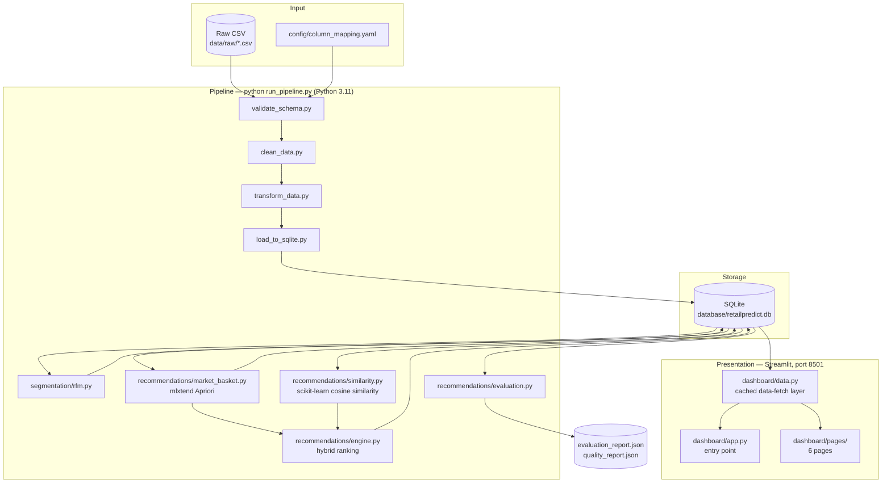

# Architecture

RetailPredict is a local batch pipeline plus a Streamlit presentation layer. There is no HTTP API and no server process beyond Streamlit itself.

[← Back to README](../README.md)

## Architecture Overview



`src/database/db.py` is the only module in the codebase that opens a SQLite connection. Every pipeline stage, analytics query, and dashboard page goes through it, so there is exactly one definition of how the database is queried and how foreign keys are enforced.

## Pipeline Execution Flow

`run_pipeline.py` runs seven stages in strict dependency order — a linear batch job, not an event-driven or saga workflow. A failure at any stage halts everything after it rather than triggering a rollback.

```mermaid
sequenceDiagram
    participant CLI as run_pipeline.py
    participant Val as validate_schema
    participant Clean as clean_data
    participant Trans as transform_data
    participant Load as load_to_sqlite
    participant DB as SQLite (retailpredict.db)
    participant RFM as segmentation/rfm
    participant MB as market_basket
    participant Eng as recommendations/engine
    participant Sim as similarity
    participant Ev as evaluation

    CLI->>Val: load_raw() + validate(df)
    Val-->>CLI: quality report (raises SchemaValidationError on failure)
    CLI->>Clean: clean(canonical_df)
    Clean-->>CLI: cleaned_df + cleaning_report
    CLI->>Trans: transform(cleaned_df)
    Trans-->>CLI: transformed_df -> clean_transactions.csv
    CLI->>Load: load(transformed_df, db_path)
    Load->>DB: CREATE TABLES (schema.sql) + bulk INSERT
    Load-->>CLI: verify() referential-integrity check
    CLI->>RFM: run(db_path)
    RFM->>DB: SELECT customer aggregates
    RFM->>DB: UPDATE customers (rfm scores, segment, segment_reason)
    CLI->>MB: run(db_path)
    MB->>DB: SELECT invoice baskets
    MB->>DB: INSERT association_rules (Apriori, mlxtend)
    CLI->>Eng: run(db_path)
    Eng->>MB: load_rules(db_path)
    Eng->>Sim: build(db_path)
    Sim->>DB: SELECT customer x product interactions
    Eng->>DB: INSERT recommendations (ranked, per customer)
    CLI->>Ev: run(db_path)
    Ev->>DB: time-based holdout split; rebuild rules/similarity on train period only
    Ev-->>CLI: evaluation_report.json (Precision/Recall/HitRate/Coverage)
```

### Failure Handling

| Stage | Failure Mode | Pipeline Behavior |
|---|---|---|
| Validate | Required column missing, or CSV unreadable | `SchemaValidationError` raised → logged → process exits `1`; no downstream stage runs |
| Validate | Raw CSV file not found at the configured path | `FileNotFoundError` caught in `main()` → logged → exits `1` |
| Clean | Every row removed by the cleaning filters | `ValueError` raised → logged → exits `1` (prevents building an empty database) |
| Load | Transactions reference an unknown customer/product | Logged as a `warning` with orphan-row counts; pipeline continues — foreign keys allow `NULL` |
| Evaluate | `--skip-evaluation` flag passed | Stage skipped entirely; pipeline still exits `0` |

## Tech Stack

### Components

| Component | Language | Runtime | Framework | Database | Role | Port |
|---|---|---|---|---|---|---|
| Pipeline CLI | Python 3.11 | CPython | argparse (stdlib) | SQLite | Batch ETL: clean, load, segment, recommend, evaluate | — (CLI) |
| Dashboard | Python 3.11 | CPython | Streamlit ≥1.30 | SQLite (read-only) | Six-page interactive BI dashboard | 8501 (default) |
| Sample data generator | Python 3.11 | CPython | argparse + NumPy | — | Synthetic UCI-shaped CSV for demo/dev | — (CLI) |

### Infrastructure and Libraries

| Component | Technology | Purpose |
|---|---|---|
| Database | SQLite (`sqlite3`, stdlib) | Single-file relational store; sole access via `src/database/db.py` |
| Data processing | Pandas ≥2.0, NumPy ≥1.24 | Cleaning, transforms, RFM computation |
| Association rules | mlxtend ≥0.23 (Apriori) | Market-basket rule mining |
| Similarity | scikit-learn ≥1.3 (cosine similarity) | Item-item recommendation tier |
| Charts | Plotly ≥5.18 | All dashboard visualizations |
| Config parsing | PyYAML ≥6.0 | Loads `config/column_mapping.yaml` |
| Testing | pytest ≥7.4 | 91 tests across data, SQL, segmentation, recommendations, dashboard |

All free and open source — no API keys anywhere in the codebase.

## Project Structure

```text
RetailPredict/
├── .github/
│   ├── logo-light.svg / logo-dark.svg   # theme-aware README wordmark
│   └── repo-meta.yml                    # GitHub description and topics
├── docs/                                # deep-dive documentation linked from README
├── config/
│   └── column_mapping.yaml      # dataset-agnostic ingestion config — remap columns, no code changes
├── data/
│   ├── raw/                     # your source CSV goes here (gitignored, .gitkeep only)
│   └── processed/                # clean_transactions.csv + quality/evaluation JSON reports (regenerated)
├── database/
│   └── retailpredict.db          # generated SQLite file (gitignored)
├── src/
│   ├── data/                     # validate_schema.py, clean_data.py, transform_data.py
│   ├── database/                 # schema.sql, load_to_sqlite.py, db.py (sole DB access boundary)
│   ├── analytics/                # customer_analytics.py, product_analytics.py, business_analytics.py, insights.py
│   ├── segmentation/             # rfm.py — quintile scoring + segment rule table
│   ├── recommendations/          # market_basket.py, similarity.py, popularity.py, engine.py, evaluation.py
│   └── utils/                    # config.py (YAML loader + paths), logging.py
├── dashboard/
│   ├── app.py                    # Streamlit entry point
│   ├── data.py                   # cached data-fetch layer — pages never touch src/database directly
│   ├── theme.py                  # colorblind-validated chart palette + Plotly styling
│   └── pages/                    # 1_Home.py … 6_Business_Insights.py (Streamlit auto-discovers these)
├── scripts/
│   └── make_sample_data.py       # synthetic UCI-shaped CSV generator for demo/dev
├── tests/                        # pytest suite mirroring src/ (91 tests)
├── run_pipeline.py                # single orchestration entry point
├── requirements.txt
└── pytest.ini
```

## Database Schema

```sql
customers(customer_id PK, country, first_purchase_date, last_purchase_date,
          total_orders, total_spend,
          recency_days, frequency, monetary,
          r_score, f_score, m_score, rfm_score, segment, segment_reason)

products(product_id PK, product_name, category)

transactions(transaction_id PK, invoice_no, customer_id FK, product_id FK,
             transaction_date, quantity CHECK(>0), unit_price CHECK(>0),
             revenue, country)

association_rules(rule_id PK, antecedent, consequent, support, confidence, lift)

recommendations(recommendation_id PK, customer_id FK, product_id FK,
                rank, score, source_method, reason_text)
```

Indexed on `customer_id`, `product_id`, `transaction_date`, `invoice_no`, `customers.segment`, `association_rules.antecedent`, and `recommendations.customer_id`.

**Design notes**

- Transactions are stored at **invoice-line grain** (one row per product per invoice), matching the source data. Invoice-level views are derived with `GROUP BY invoice_no` rather than a physical header table — no redundant joins for a portfolio-scale project.
- `association_rules` and `recommendations` are **materialized by the pipeline**. Mining Apriori rules takes seconds; doing it on every dashboard page load would be unusable.
- Foreign keys are enforced via `PRAGMA foreign_keys = ON` on every connection — SQLite disables them by default, per connection, so the schema's `REFERENCES` clauses would otherwise be decorative.
